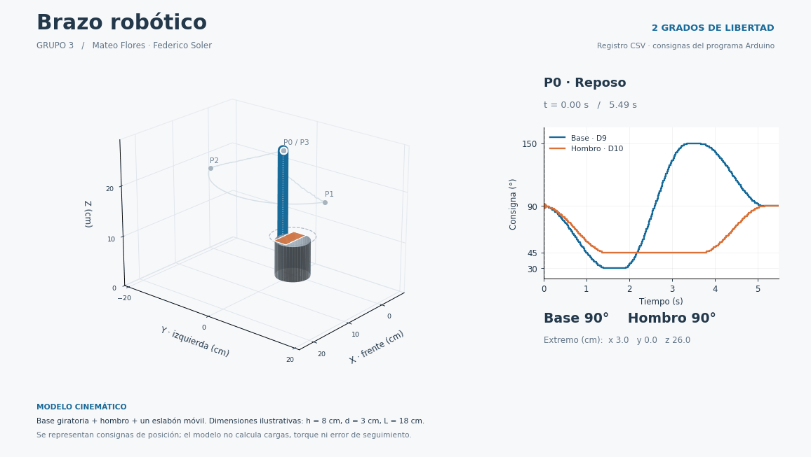

# Brazo de hombro y codo — movimientos independientes

**Grupo 3 · Mateo Flores y Federico Soler**

Introducción a la Robótica · Universidad de Palermo

Esta versión representa la cadena **hombro → húmero → codo → antebrazo → muñeca**, con dos servomotores y movimientos alternados. La muñeca es el efector final y no agrega una articulación motorizada.

[](https://colab.research.google.com/github/federicosolerup/brazo-robotico-arduino-wokwi/blob/main/Brazo_Robotico_Grupo3.ipynb)

## Ver el resultado



- [Descargar el reproductor HTML](salidas/brazo_interactivo.html?raw=true), guardarlo y abrirlo en Chrome o Edge. Luego presionar ▶. Funciona sin internet y permite pausar o recorrer los cuadros.
- [Ver o descargar el video MP4](salidas/brazo.mp4?raw=true).
- [Abrir el notebook en Colab desde GitHub](https://colab.research.google.com/github/federicosolerup/brazo-robotico-arduino-wokwi/blob/main/Brazo_Robotico_Grupo3.ipynb) y elegir **Entorno de ejecución → Ejecutar todas**. La captura está incluida. También se puede [leer el notebook en GitHub](Brazo_Robotico_Grupo3.ipynb).
- [Ver las cinco configuraciones](salidas/) o consultar [el texto sugerido para el informe](TEXTO_PARA_DOCS.md).

El notebook interactivo se ejecuta en Colab o en el HTML descargado; GitHub muestra una vista estática del notebook.

Esta versión reemplaza el modelo anterior de giro de base y hombro. El repositorio y el enlace público del notebook mantienen sus direcciones anteriores para conservar las referencias del informe.

## Anatomía y movimientos

| Elemento | Representación |
|---|---|
| Hombro | Articulación fija al torso, accionada por el servo de D9 |
| Húmero | Primer eslabón, de 18 cm ilustrativos |
| Codo | Articulación transportada por el húmero, accionada por el servo de D10 |
| Antebrazo | Segundo eslabón, de 15 cm ilustrativos |
| Muñeca | Extremo del antebrazo y efector final, sin tercer servo |

La animación usa una vista lateral en un plano vertical. No hay giro de base ni plataforma giratoria.

El ángulo del hombro se mide respecto de la horizontal. El ángulo del codo es **relativo al húmero**, con 0° como extensión completa del brazo. Por eso, cuando el hombro gira, el codo cambia su ubicación en el espacio y el antebrazo acompaña al húmero, pero la flexión del codo permanece fija. Eso es movimiento mecánico de la cadena, no la activación simultánea de las dos articulaciones.

El servo que mantiene su ángulo conserva su señal de control; no se desconecta durante el ciclo. El objetivo es que las consignas de posición nunca cambien simultáneamente.

## Secuencia

| Tramo | Articulación que se mueve | Hombro | Codo |
|---|---|---:|---:|
| P0 · Reposo | Ninguna | 30° | 30° |
| P0 → P1 | Hombro | 30° → 75° | Fijo en 30° |
| P1 → P2 | Codo | Fijo en 75° | 30° → 90° |
| P2 → P3 | Hombro | 75° → 30° | Fijo en 90° |
| P3 → P4 | Codo | Fijo en 30° | 90° → 30° |

Cada tramo tiene un perfil cúbico de 1500 ms y una pausa de 300 ms al terminar. Se utiliza `q(t) = q0 + (qf − q0)(3s² − 2s³)`, con `s = t/T`. La velocidad ideal es nula en los extremos; la aceleración no necesariamente lo es.

El arranque del programa también es escalonado: primero se conecta y posiciona el hombro y se espera 1500 ms; después se conecta y posiciona el codo y se espera otro intervalo de 1500 ms. El pulsador queda listo al terminar esa inicialización. Mantenerlo presionado no repite el ciclo.

## Datos y verificación

Se ejecutaron el nuevo sketch y el nuevo diagrama en Wokwi, usando una sesión temporal del editor del proyecto anterior. No se guardaron cambios ni se publicó un proyecto nuevo de Wokwi. La evidencia de la ejecución está en [salidas/captura_wokwi.png](salidas/captura_wokwi.png).

La captura contiene **363 registros y 7,343 segundos**, con este encabezado:

```csv
ciclo,tiempo_ms,hombro_deg,codo_deg,fase
```

Se registran los enteros enviados a `Servo.write()`. La impresión serial agrega una pequeña carga; la visualización usa el tiempo real registrado por `millis()` y mantiene cada consigna hasta la siguiente muestra.

La verificación compara muestras consecutivas y comprueba que **no cambien a la vez hombro y codo**. También verifica los extremos y la articulación inmóvil de cada tramo, el orden de las cinco configuraciones y el regreso a reposo. El lector rechaza capturas con cambios simultáneos, incluso si ocurren entre filas con la misma marca temporal.

- [Captura CSV](datos/captura_wokwi.csv).
- [Resultados de verificación](datos/verificacion.json).
- [Procedencia y huellas SHA-256](datos/procedencia.json).

## Cinemática directa

El hombro se ubica en `(0,h)`, con altura ilustrativa `h = 12 cm`. Si `q1` es el ángulo del hombro y `q2` la flexión del codo:

```text
x_codo = L1 cos(q1)
z_codo = h + L1 sin(q1)

x_muñeca = L1 cos(q1) + L2 cos(q1 + q2)
z_muñeca = h + L1 sin(q1) + L2 sin(q1 + q2)

L1 = 18 cm (húmero)
L2 = 15 cm (antebrazo)
```

Los cálculos convierten los grados a radianes. Las longitudes son ilustrativas, sin medición de un prototipo físico. Se visualizan consignas; no se calculan torque, carga, colisiones ni error de seguimiento de un servo real.

## Usar otro registro

1. Pegar [wokwi/sketch.ino](wokwi/sketch.ino) en un proyecto Arduino UNO de Wokwi y cargar [wokwi/diagram.json](wokwi/diagram.json).
2. Mantener la biblioteca `Servo` de [libraries.txt](wokwi/libraries.txt).
3. Iniciar la simulación y esperar a `# LISTO` antes de presionar el pulsador.
4. Esperar a `# FIN_CICLO`, copiar el monitor serie con su encabezado y guardarlo como CSV UTF-8.
5. En el notebook, elegir `MODO = "subir_csv"` o `"pegar_csv"`. El formato anterior de base/hombro no corresponde a esta versión.

## Ejecutar localmente

```powershell
python -m pip install -r requirements.txt
python visualizar_brazo.py --csv datos/captura_wokwi.csv --gif --mp4
```

MP4 requiere FFmpeg en PATH. El HTML y el GIF no lo necesitan. Sin `--csv`, se genera una demostración teórica identificada expresamente.

## Referencias

- Universidad de Palermo. *Trayectorias* e *Implementación de las trayectorias robóticas*. Apuntes del módulo 6 de Introducción a la Robótica.
- [Monitor serie de Wokwi](https://docs.wokwi.com/guides/serial-monitor).
- [Servo de Wokwi](https://docs.wokwi.com/parts/wokwi-servo).
- [Animaciones de Matplotlib](https://matplotlib.org/stable/api/animation_api.html).
